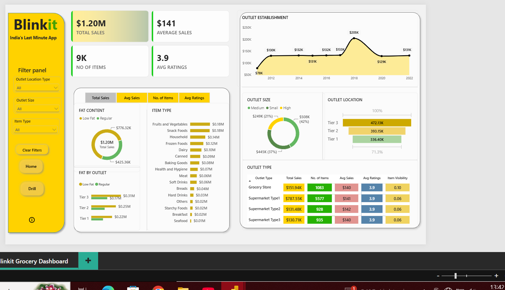
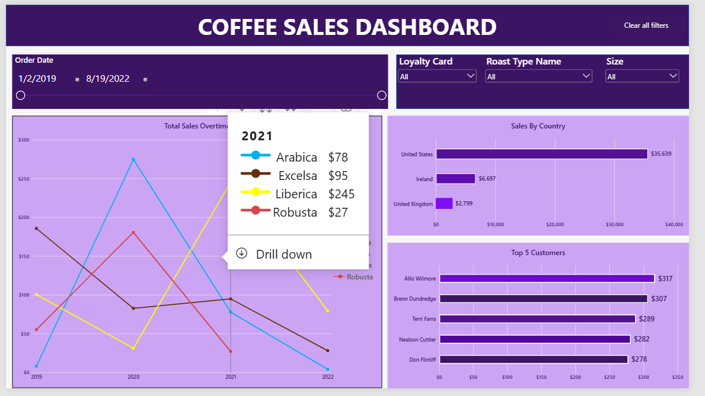
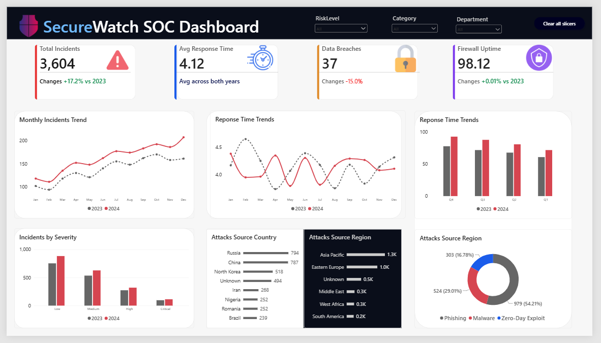
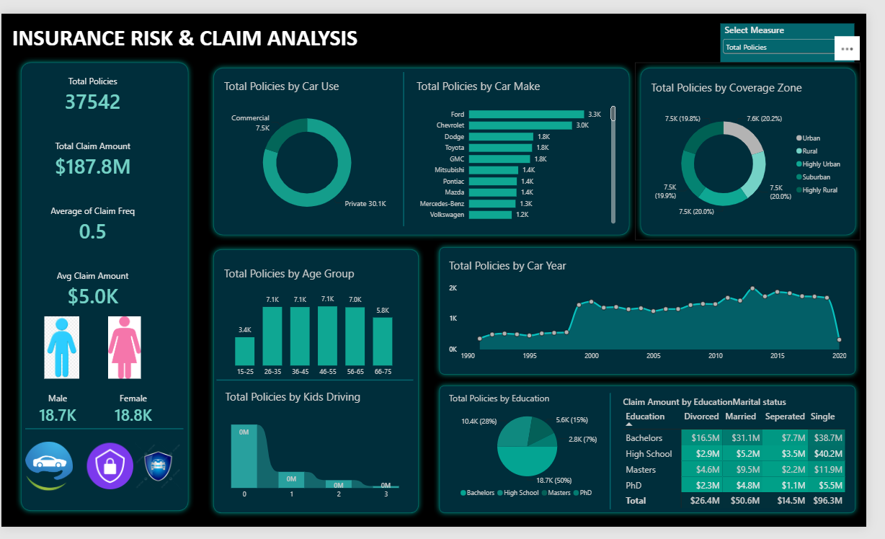
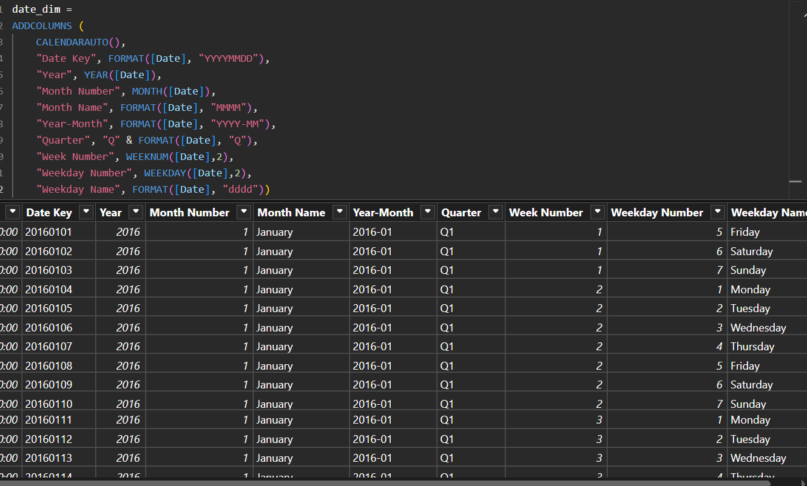

# 📊 Power BI Data Analytics & Business Intelligence Portfolio

### Transforming Data into Insights. Turning Insights into Decisions.

Welcome to my **Power BI Dashboard Portfolio**, showcasing interactive business intelligence projects developed to transform raw data into meaningful insights, identify trends, monitor performance, and support data-driven decision-making.

---

## 🚀 Featured Projects

### 1. 🛒 Blinkit Grocery Sales Dashboard

**Objective:** Analyze grocery sales performance, outlet characteristics, product categories, and customer ratings to uncover business growth opportunities.

**Key Metrics:**
- 💰 Total Sales: $1.20M
- 📦 Number of Items: 9K
- 📈 Average Sales: $141
- ⭐ Average Rating: 3.9

**Key Insights & Storytelling:**
- Compared outlet performance across different establishment years.
- Identified sales contributions by item type and fat content.
- Analyzed outlet size and location tier performance.
- Evaluated grocery outlet types using sales, item count, and customer ratings.

**Business Value:** Helps management understand product performance, outlet distribution, and sales patterns for better retail decisions.

---

### 2. ☕ Coffee Sales Dashboard

**Objective:** Explore coffee sales trends, geographical performance, product preferences, and customer purchasing behavior.

**Key Insights & Storytelling:**
- 📅 Analyzed sales performance over time (2019–2022).
- 🌍 Compared sales across the United States, Ireland, and the United Kingdom.
- 🏆 Identified the top five customers by sales.
- ☕ Compared coffee roast categories and product sizes.
- 🎯 Incorporated loyalty card and date filters for interactive analysis.

**Business Value:** Provides insights into customer value, geographical sales distribution, and product performance to support marketing and sales strategies.

---

### 3. 🔐 Cybersecurity SOC Dashboard

**Objective:** Monitor security incidents, response times, data breaches, firewall uptime, and attack patterns.

**Key Metrics:**
- 🚨 Total Incidents: 3,604
- ⏱️ Average Response Time: 4.12
- 🔒 Data Breaches: 37
- 🛡️ Firewall Uptime: 98.12

**Key Insights & Storytelling:**
- Monitored monthly incident trends across 2023 and 2024.
- Compared incident severity levels.
- Analyzed attack source countries and geographical regions.
- Explored attack categories, including phishing, malware, and zero-day exploits.
- Compared response-time patterns across reporting periods.

**Business Value:** Supports security monitoring, incident prioritization, and operational performance evaluation.

---

### 4. 🚗 Insurance Risk & Claims Analysis Dashboard

**Objective:** Analyze insurance policy distribution, claims, customer demographics, and vehicle-related risk patterns.

**Key Metrics:**
- 📋 Total Policies: 37,542
- 💰 Total Claim Amount: $187.8M
- 📊 Average Claim Frequency: 0.5
- 💵 Average Claim Amount: $5.0K

**Key Insights & Storytelling:**
- Compared policy distribution across car makes and usage types.
- Analyzed policyholders across different age groups.
- Explored policy distribution by vehicle manufacturing year.
- Examined relationships between education, marital status, and claim amounts.
- Investigated policy distribution across coverage zones and demographic categories.

**Business Value:** Helps insurance stakeholders understand portfolio composition, claims distribution, and potential risk patterns.

---

## 🛠️ Technical Skills Demonstrated

| Skill | Application |
|---|---|
| Power BI | Interactive dashboard development |
| Power Query | Data preparation and transformation |
| DAX | Measures, KPIs, and calculations |
| Data Modeling | Organizing analytical data |
| Data Visualization | Charts, cards, tables, and KPI displays |
| Business Intelligence | Translating data into business insights |
| Data Storytelling | Communicating findings through visuals |
| Interactive Reporting | Slicers, filters, and drill-down analysis |
| Dashboard Design | Layout, themes, and visual consistency |

## 📌 Core Analytical Capabilities

- KPI development and performance monitoring.
- Trend and comparative analysis.
- Customer and product segmentation.
- Geographical and demographic analysis.
- Risk and operational performance monitoring.
- Interactive filtering and exploration.
- Business-focused insight communication.

## 🎯 My Approach to Data Storytelling

My dashboard development process focuses on four principles:

1. **Understand:** Identify the business problem and analytical objectives.
2. **Transform:** Prepare and organize data for meaningful analysis.
3. **Visualize:** Build interactive dashboards that communicate important metrics and patterns.
4. **Communicate:** Translate analytical findings into actionable business insights.
___
#### [*View Power Bi Profile Readme Page*](/readme.md)

**Tools:** Microsoft Power BI | DAX | Power Query | Data Visualization | Business Intelligence
