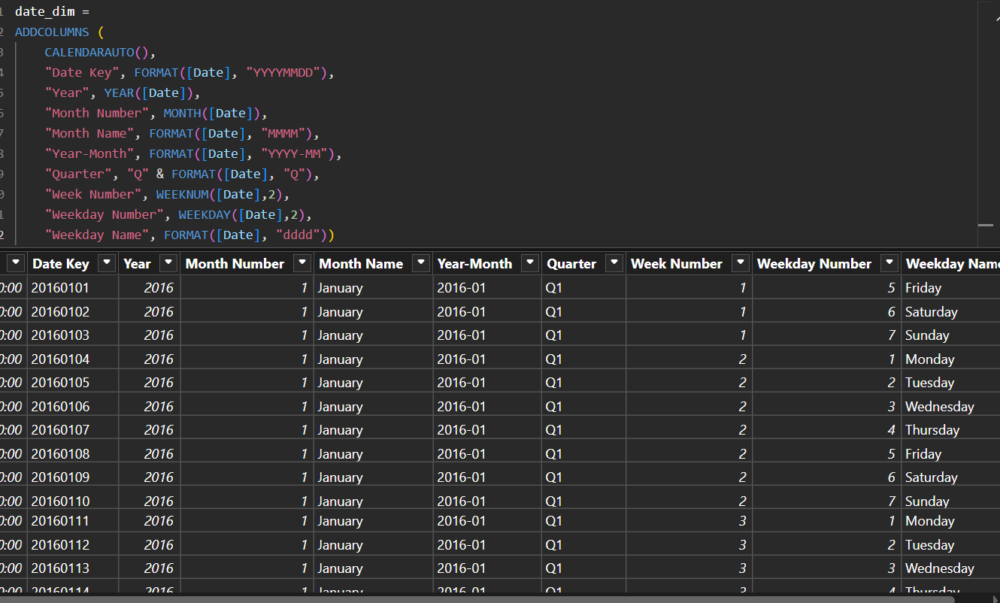
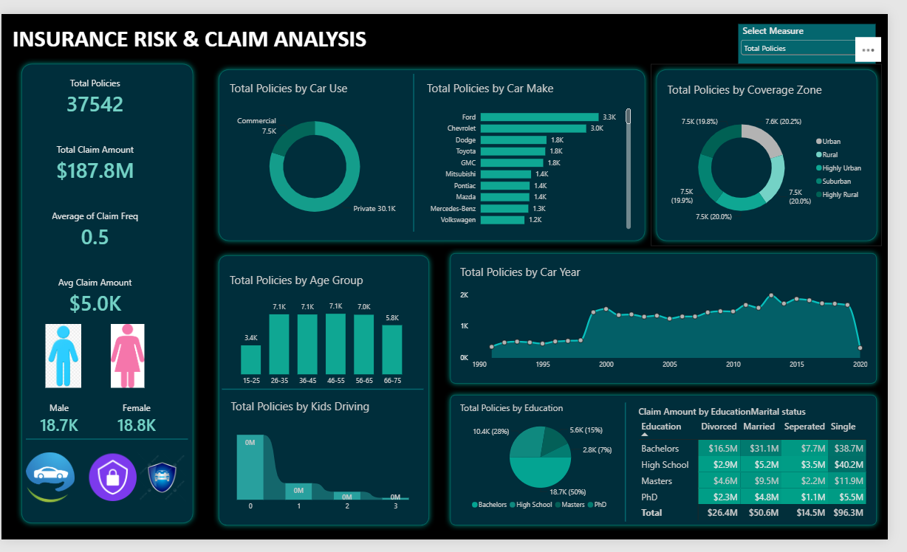

<h1 align="center">Hi 👋, I'm Benard Maina</h1>
<h3 align="center">Aspiring Data Analyst | Power BI Enthusiast | Agribusiness Management Graduate-in-Progress</h3>

  Turning data into meaningful insights through analytics and visualization.

### 👨‍💻 About Me

I'm a BSc Agribusiness Management with IT student passionate about data analytics, business intelligence, and data-driven decision-making.

I enjoy transforming raw data into meaningful insights that support business performance, financial analysis, and strategic planning.

Currently developing my skills in **Microsoft Power BI, Excel, and data analytics**, with a particular interest in applying data analytics to agribusiness and financial management.

### 🛠️ Technical Skills

**Data Analytics & Business Intelligence**
- Power BI
- Power Query (Data Cleaning & Transformation)
- DAX (Data Analysis Expressions)
- Data Modelling & Relationships
- Data Visualization
- Interactive Dashboards & Reports
- KPI Development and Performance Analysis

**Other Technical Skills**
- Microsoft Excel (Advanced Excel)
- Data Cleaning and Preparation
- Basic SQL
- Business and Financial Analysis

### 📊 Power BI Skills

| Skill | Competency |
|---|---|
| Power Query | Data cleaning and transformation |
| DAX | Measures, calculated columns and KPIs |
| Data Modelling | Relationships and schema design |
| Visualization | Charts, graphs and interactive reports |
| Dashboards | Interactive business intelligence dashboards |
| Data Analysis | Identifying trends and generating insights |
---

### 🎯 Areas of Interest

- Data Analytics and Business Intelligence
- Financial Modelling and Analysis
- Agribusiness Analytics
- Business Performance Analysis
- Data-Driven Decision Making

### 🚀 Current Focus

- Improving my Power BI and DAX skills.
- Building practical data analytics projects.
- Developing interactive business dashboards.
- Learning SQL and advanced financial modelling.
- Applying analytics to real-world business and agricultural challenges.

#### [View Power BI Projects Dashboards Readme](./Dashboards.me/README.md)

### 🤝 Connect With Me

  
  
   
  

---

  <i>"Turning data into insights, and insights into better decisions."</i>

